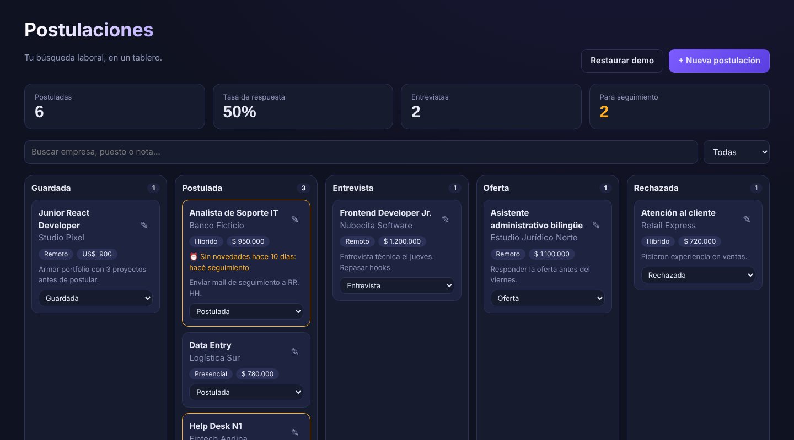

# Postulaciones

Tablero Kanban para organizar una búsqueda laboral: guardás ofertas, las movés entre etapas (arrastrando o con un selector), ves tus métricas y la app te avisa qué postulaciones necesitan seguimiento.



## Funciones
- Etapas: Guardada → Postulada → Entrevista → Oferta → Rechazada.
- **Drag & drop** nativo (HTML5) y `<select>` como alternativa accesible/mobile.
- Métricas: postuladas, tasa de respuesta, entrevistas y pendientes de seguimiento.
- Alerta cuando una postulación lleva 7 días o más sin novedades.
- Búsqueda, filtro por modalidad, alta/edición/baja con validación, datos guardados en el navegador.

## Lógica testeada
Las reglas viven en `src/logic.js` (funciones puras) y tienen tests con el runner de Node:
```bash
node --test src/logic.test.js
```

## Correr
```bash
npm install && npm run dev     # desarrollo
npm run build                  # producción
```
Deploy a GitHub Pages: ver `.github/workflows/deploy.yml` (Settings → Pages → Source: GitHub Actions).

## Transparencia
Desarrollado con asistencia de IA (Claude). Reviso y puedo explicar cada decisión: ver [NOTAS-ENTREVISTA.md](NOTAS-ENTREVISTA.md).
